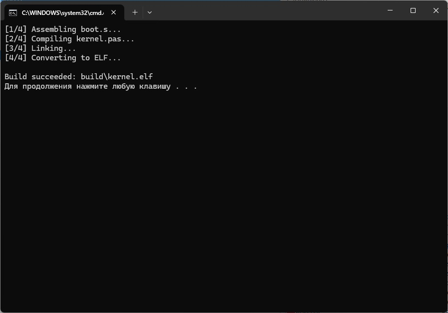
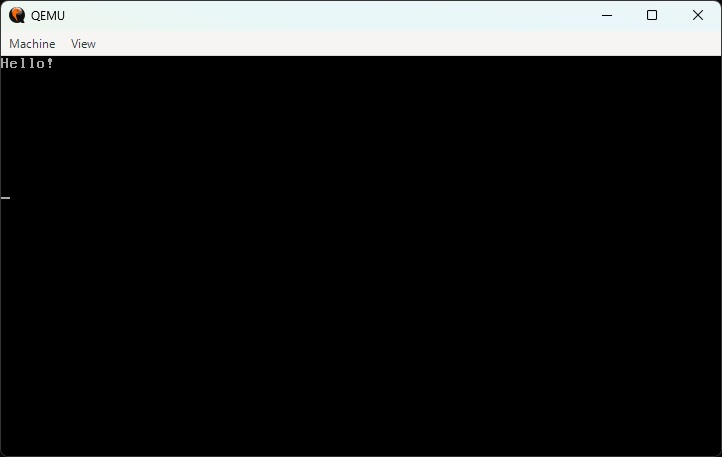

# FpcOs

An experimental 32-bit x86 operating system kernel written in **Free Pascal** and **Assembly**.

This project explores bare-metal OS development without a standard runtime library, implementing low-level hardware initialization, custom RTL units, and a bootable ELF kernel image.

## Features
- **Custom Minimal RTL** (`System.pas`, `ObjPas.pas`) tailored for freestanding bare-metal execution
- **Boot & Entry** (`boot.s`, `Kernel.pas`, `Main.pas`) with Multiboot support
- **Descriptor Tables & Interrupts** (`GDT.pas`, `Interrupt.pas`, `interrupts.s`)
- **Programmable Interrupt Controller** (`PIC.pas`) setup and IRQ remapping
- **Hardware I/O** (`PortIO.pas`, `MemoryIO.pas`) for low-level port and memory access
- **VGA Text Console** (`Console.pas`) for screen output

## Screenshots

| Build Process | Running in QEMU |
| :---: | :---: |
|  |  |

## Prerequisites
To build and run FpcOs on Windows, you will need:
- **Free Pascal Compiler (FPC)** configured for `i386` target
- **GNU Binutils** (`as`, `ld`, `objcopy`)
- **QEMU** (`qemu-system-i386`)

## Build & Run

1. **Build the kernel:**
   Run the build script to assemble, compile, link, and convert the kernel into `build/kernel.elf`:
   ```cmd
   build.bat
   ```

2. **Run in QEMU:**
   Launch the compiled kernel in the emulator:
   ```cmd
   run.bat
   ```

## Development Notes & Local AI Workflow
Part of this experiment is testing how far a **local LLM** can assist in low-level operating system development. 

Rather than blindly copy-pasting generated snippets—which rarely work out of the box in bare-metal environments—the AI is used primarily as an interactive reference book for x86 architecture, hardware specifications, and low-level programming concepts. Nearly half of any suggested code still requires manual rewriting, debugging, and adaptation to fit Free Pascal's freestanding constraints.

The local model is hosted via `llama.cpp` (`llama-server`) using the following setup:
```cmd
llama-server.exe ^
  --model "Models\gemma-4-26B-A4B-it-UD-Q4_K_XL.gguf" ^
  --ctx-size 32592 ^
  --flash-attn on ^
  --threads 6 ^
  --threads-batch 6 ^
  --batch-size 2048 ^
  --ubatch-size 512 ^
  --parallel 1 ^
  --reasoning off
```

## Project Structure
```text
FpcOs/
├── src/
│   ├── boot.s          # Assembly entry point and Multiboot header
│   ├── interrupts.s    # Low-level ISR / IRQ assembly stubs
│   ├── Kernel.pas      # Kernel entry point
│   ├── Main.pas        # Main kernel initialization and logic
│   ├── System.pas      # Custom freestanding System unit
│   ├── ObjPas.pas      # Minimal ObjPas runtime stub
│   ├── GDT.pas         # Global Descriptor Table setup
│   ├── Interrupt.pas   # Interrupt Descriptor Table (IDT) & handlers
│   ├── PIC.pas         # 8259 PIC initialization
│   ├── PortIO.pas      # x86 I/O port read/write routines
│   ├── MemoryIO.pas    # Direct memory access helpers
│   └── Console.pas     # VGA text-mode console driver
├── screenshots/        # Build and QEMU preview images
├── linker.ld           # Linker script
├── build.bat           # Build automation script
├── run.bat             # QEMU launch script
├── gpl-3.0.txt         # GNU General Public License v3.0
└── readme.md           # Project documentation
```

## License
This project is licensed under the **GNU General Public License v3.0** — see the [gpl-3.0.txt](gpl-3.0.txt) file for details.
